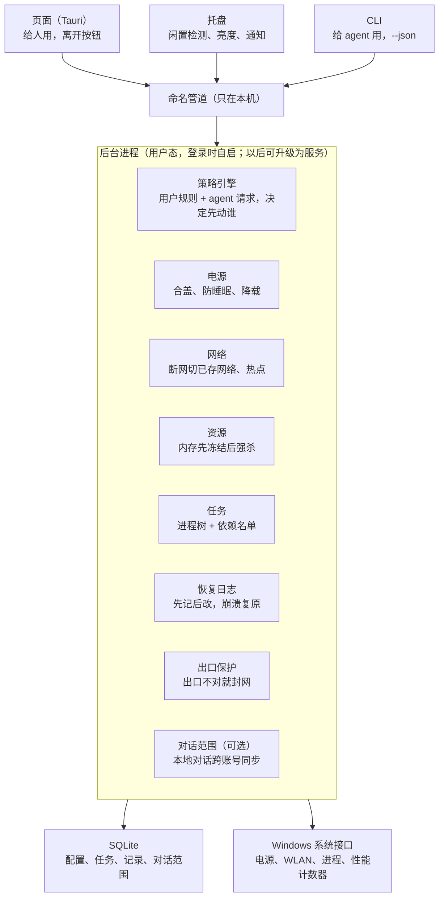

# Arcturus（大角星）架构

项目名定为 Arcturus（大角星），希腊语原意是"熊的守护者"，它是牧夫座最亮的星。代码里的暂名 `away-guard` 等各对话手上的活告一段落后再统一改，名字都集中在 `crates/proto/src/names.rs`。crates.io 上 `arcturus` 已被一个 2021 年后没再更新的零知识证明库占用；我们是应用程序，不一定要发布到 crates.io，真要发布就用别的包名。

更新：2026-11-01

## 原则

页面、托盘、CLI 都不直接操作系统，只向后台进程发请求。页面崩了，保护规则还在。

## 定位

这是一个整合工具：把几件和 agent 相关的本地杂事，放进同一个后台进程和同一个界面。现成开源项目能用的就接过来，接之前先看许可证。分三部分，共用同一套骨架（后台进程、CLI、页面、托盘）：

1. **使用：** 人离开后，程序怎么继续跑。包括电源、网络（断网切换）、任务保护、资源（内存、显存）、网恢复后让 agent 继续、API 中转。先做这一部分。
2. **账号和存储：** 本地对话的跨账号范围、对话搜索、文件归属、清理和归档。
3. **保护：** 出口保护（VPN 或代理的出口不对就封网），以及权限名单（哪些程序 agent 能动）。

## 架构图

## 已定的决定

- **后台进程：** 第一版是普通用户态进程，登录时由任务计划程序启动，不做 SYSTEM 服务。等需要结束管理员权限的程序时，再升级成服务。
- **权限边界：** 在同一个 Windows 账号下，"agent 只能申请、不能改权限"强制不了，因为 agent 可以直接用 `taskkill`、`powercfg`，或者改数据库。所以这一版定位成"给守规矩的 agent 用的接口"。要硬隔离的话，规则库得放在只有管理员能写的位置，改规则走 UAC。
- **保护兜底：** 过热和低电量保护优先于所有任务。
- **内存、显存：** 见下面"资源模块"一节。
- **温度：** 不用管理员就能读主板温区（ACPI，WMI 类 `Win32_PerfFormattedData_Counters_ThermalZoneInformation`），但很粗。精确的核心温度要内核驱动，暂时不做。
- **网络：** 见下面"网络模块"一节。
- **平台：** 先只支持 Windows，等用的人多了再做 Linux 和 macOS。Linux 先做，因为在这台笔记本上用 U 盘启动就能测；macOS 要借真机测。骨架现在就要把位置留好：通信层和系统调用都放在接口后面；模块接口和协议里不出现 Windows 专有的东西；数据目录按各平台的惯例取。

## 管理员服务

后台进程照旧在用户的桌面会话里运行，因为锁屏、关显示器、闲置检测、弹通知只能在那里做。另外加一个很小的 Windows 服务，专门执行需要管理员权限的操作。

- **只做固定的几件事：** 也就是骨架里"管理员那一层"接口列出的操作，比如推迟系统更新、改网卡优先级、关网卡省电、结束用管理员权限运行的程序；以后再加出口保护的防火墙规则、文件写入记录。不提供任何"执行任意命令"的接口，每个参数都要检查。
- **只听自己人的：** 只接受我们自己后台进程的请求。通信管道只对当前用户开放，并且核对发请求的程序路径。
- **没装也能用：** 服务没装时，自动退回普通权限，这些操作照旧回"需要管理员权限"，其他功能不受影响。
- **安装：** 装和卸都要一次管理员授权。在用户电脑上安装之前，先问用户。

## agent 适配层

不只支持 Claude Code。第一版就完整支持 Claude Code 和 Codex；其他 agent 程序（DeepSeek 相关的命令行工具、Kimi CLI、Qwen Code 等），能支持的都加上。

- **按程序适配，不按模型。** 很多国产模型（DeepSeek、Kimi、GLM 等）可以直接在 Claude Code 里用，这种情况只要支持 Claude Code 就够了。需要单独适配的，是不同的 agent 程序。
- **每个 agent 一个适配器。** 和模块一样，一个目录、一处登记。适配器要说明：
  - 这个 agent 的可执行程序叫什么（任务保护、默认白名单要用）；
  - 对话记录存在哪、什么格式，读出来后转成统一格式：对话、消息、工具调用、写过的文件、执行过的命令、工作目录；
  - 有没有 hook，能不能靠 hook 自动登记保护、断网后让它继续；
  - 怎么认出版本。
- **格式认不出就停手。** 各家的存储位置和格式经常变，比如 Kimi CLI 不同版本的文档里，对话目录就不一样。适配器认不出时，只报告"这个版本不认识"，不去猜。
- **能力不同，功能自动降级。** 有 hook 的 agent 才能自动保护、断网后续跑，没有 hook 的只能通知。对话跨账号同步目前只针对 Claude 桌面应用。
- **功能代码只认统一格式。** 文件归属、对话搜索、任务保护、网恢复续跑，都只读适配器转出来的统一格式，代码里不出现具体某个 agent 的名字。以后加新 agent，这些功能都不用改。
- **借用现成的：** cass 已经能读很多家 agent 的对话记录。先看它的许可证，能借就借它对各家格式的了解。

## 模式（总开关）

三种模式：

- **普通模式（人在）：** 只做不打扰人的事。遇到问题只通知，由人决定怎么办。
- **离开模式（人不在）：** 替人动手，用一套固定的推荐设置。
- **自定义模式：** 初始设置和离开模式完全一样，用户可以逐项修改。数据结构要支持以后加多套自定义模式。

普通模式和另外两种模式的区别只有一个：有没有人在电脑前，能自己处理问题。

**所有模式都做**（只帮受保护的任务，不影响人正在用的东西）：有受保护的任务时防止闲置睡眠、网恢复后让 agent 继续、出口保护、过热和低电量保护。

**离开模式会做、自定义模式可以逐项改的**（会影响人正在用的程序、会花钱、或者要改系统设置）：

| 项目 | 离开模式（固定） | 自定义模式 |
|---|---|---|
| 锁屏 | 开 | 开 / 关 |
| 屏幕 | 关 | 关 / 调暗 / 常亮 |
| 内存不够时冻结、强杀别的程序 | 开 | 开 / 关 |
| 断网后自动切到手机热点 | 开 | 开 / 关 |
| 推迟系统更新这类会打断运行的东西 | 开 | 开 / 关 |
| 插着电时合盖继续跑 | 开 | 开 / 关 |
| 用电池时合盖继续跑 | 关 | 开（要设电量下限）/ 关 |
| 关掉网卡和 USB 口的省电 | 开 | 开 / 关 |
| 离开报告 | 开 | 开 / 关 |

普通模式和离开模式遇到问题时的对比：

| 情况 | 普通模式 | 离开模式 |
|---|---|---|
| 内存不够 | 通知，列出占用多的程序 | 自动冻结，还不够就强杀 |
| 断网 | 通知 | 自动切到手机热点 |
| 过热 | 提醒，压低 CPU 频率；不冻结程序 | 压低频率，冻结低优先级的程序 |
| 快没电或温度到紧急线 | 先倒计时提醒保存，再休眠 | 直接休眠 |

- **怎么进入离开模式或自定义模式：**
  - **按钮：** 页面上的按钮、托盘图标，可以选用哪一套。
  - **CLI：** `away`，可以指定用哪一套。agent 也能调用。
  - **合盖：** 有受保护的任务时，合盖就算离开；没有任务就照常睡眠。
  - **闲置自动进入：** 设置项，时间由用户自己设，默认关闭。离开模式会锁屏、冻结程序，误进入很打扰人；而防止睡眠是所有模式都做的，所以不开这一项，任务也不会因为电脑闲置而停掉。
  - 合盖、闲置自动进入、CLI 没指定用哪一套时，按一个设置项来定，默认用离开模式。
  - 用按钮或 CLI 主动进入时，不管有没有受保护的任务，电脑都保持运行（主动按，说明用户明确想让电脑继续跑）。合盖和闲置自动进入，只在有受保护的任务时才生效。
- **怎么回来：**
  - 锁屏开着时，解锁就算回来。
  - 锁屏关着时，检测到键盘或鼠标有动静，就弹框问"回来了吗？"，点"是"才退出，避免猫踩键盘、碰到桌子这类误触。
  - 也可以直接按"回来"。
  - 收尾按相反的顺序：先解冻所有程序，再恢复所有改过的设置。
- **离开报告：** 回来时弹出，内容包括：离开了多久、断网几次共多久、冻结或强杀了哪些程序、最高温度、agent 自动续了几次。

## 电源模块

电源模块管整台机器这一层：睡不睡、合盖怎么办、太热或没电时怎么收场。冻结、结束具体程序归资源模块：电源模块只发出"过热"之类的事件，由资源模块去处理。

- **防止睡眠：** 有任务需要保护，或进入离开模式时，向系统申请"别睡"，附上理由（`powercfg /requests` 能看到）。任务一结束就撤掉。
- **合盖：** 保护期间把合盖操作改成"不采取任何操作"，结束后改回原值。监听合盖和开盖，合盖时温度阈值收紧。
- **用电池时合盖继续跑：** 做成设置项，由用户选开或关。选了开，就要设电量下限。
- **过热、低电量：** 分三级。提醒 → 降温（压低 CPU 最高频率、切到最佳能效、发"过热"事件给资源模块）→ 休眠。最后一步默认用休眠，可以改。温度阈值等合盖实测（第 2 件）后再定。
- **离开 / 回来：** 离开模式锁屏、关显示器，自定义模式可以改。回来时把改过的全部恢复。
- **任务全部做完：** 默认恢复正常；"做完立刻休眠"作为可选项。还有续跑在等或在跑时不算做完，见"网恢复后让 agent 继续"。
- **状态读数：** 电量、是否插电、合盖状态、温度、预计续航（按实际放电速度算）、当前有哪些"别睡"的申请。
- **恢复日志：** 合盖设置、CPU 频率上限、电源模式、亮度，改之前都先记原值。
- **离开期间推迟会打断运行的东西：**
  - Windows 更新自动重启：用活动时间或暂停更新来推迟。
  - 系统节电模式：关掉它的自动打开。
  - 网卡和 USB 省电：离开期间关掉。
  - 别的程序在等待重启装更新：只提醒，不让它们自己重启。
- **管理员权限：** 首选安装时授权一次，写一条"有用户登录时不自动重启"的策略（家庭版认不认要实测）。后备方案是后台升级成服务。

## 任务保护模块

- **怎么登记：**
  - 用户在任务页里，从正在运行的程序中选。
  - agent 用 CLI 的 `protect` 登记，比如保护它刚启动的训练脚本。
  - 自动登记 Claude Code、Codex 的对话：设置项，默认关闭。打开后，对话一开始就通过 hook 自动登记，结束时自动取消。
- **跟踪进程树：** 用 Windows 的作业对象（Job Object），任务后来启动的子进程会自动算进来。整棵树一共占多少内存也靠它统计，"受保护任务自己的内存上限"就靠这个实现。有一条硬规定：不能开作业对象的"关闭时结束所有进程"选项，后台崩了，任务也不能跟着被结束。
  - **已知问题，还没修，等用户决定（2026-11-02 实测）：** `claude.exe` 自己就在一个作业里，这个作业在它退出时结束所有成员，但成员的子进程可以悄悄脱离。保护 Claude Code 时，我们的作业嵌在那个作业里面，它后来启动的进程留在我们的作业里，脱离不了，它一退出就全被结束。没保护时，隔一层的子进程能活下来。所以保护 Claude Code 本身，可能让它启动的后台程序（比如训练脚本）随它退出而结束。续跑辅助进程就是这样死的，普通后台程序没单独测过。只保护后台程序本身（`protect` 登记训练脚本）不受影响。
- **依赖名单：** 记录任务依赖、但不在它进程树里的程序，比如 WSL、Docker、数据库、终端窗口、Claude 应用。能自动识别的就自动加：发现任务里调用了 `wsl` 或 `docker`，就把对应的后台进程也加进来。
- **有效期：**
  - 进程一退出，保护就自动取消。所有任务都结束后，电源恢复正常设置。
  - 连续 10 分钟没有任何活动，就当成卡死，取消保护并通知用户。CPU、硬盘读写、网络收发、GPU、对话记录更新，任何一项有动静都算活动。
  - 要长时间等待的任务（比如等远程作业跑完），由 agent 调用 `renew` 续期。
- **取消保护：** agent 可以取消任何保护，包括用户登记的。每次取消都记下是谁、什么时候取消的，写进记录页和离开报告。
- **优先级：**
  - 决定腾内存时先动谁。
  - 同时会改系统层面的进程优先级，但最高只到"高"，绝不用"实时"："实时"会让鼠标、键盘乃至整个系统卡住，连我们自己的后台也会被卡住。改之前先记原值，取消保护时恢复。用管理员权限启动的程序，改它的优先级也要管理员权限。

## 资源模块

- **什么时候动手：** 普通模式下只通知，列出占用内存多的程序，由用户决定关不关。离开模式下（以及打开了这一项的自定义模式下）直接按下面的规则执行。回来时全部解冻。
- **处理顺序：**
  1. 可用内存低于 10%：冻结。整棵进程树一起冻，冻住后它的内存会被挪到硬盘上。
  2. 冻结后等 30 秒，可用内存还低于 10%：强杀。
  - 阈值和等待时间都可以改。
- **谁会被冻结、强杀：** 除了"不能关"名单（见下面"权限名单"一节）里的程序，其余都可以。按占用内存从大到小处理，微信排在最后，因为重新登录可能要在手机上确认。
  - 浏览器：整棵进程树一起冻。真要杀，浏览器的代价最小，重新打开能恢复标签页。建议先打开 Edge 的睡眠标签页或 Chrome 的节省内存。
- **agent 用 `free` 申请腾内存**（比如"给我腾出 8 GB"）：普通模式下通知用户，由用户决定关哪些；离开模式下直接按上面的规则执行。返回实际腾出了多少。
- **受保护的任务自己的内存上限：** 超了就不再为它腾内存，改成通知。否则 agent 自己内存泄漏时，把别的程序全冻了、杀了，也只是让它晚一点崩。
- **冻结的限制：** 内存只是被挪到硬盘上，不是真正释放，仍占用"物理内存 + 页面文件"的总额度。
- **显存：** 只显示用量，加一个可选上限：超了就结束占显存、又不在保护名单里的程序。不做别的。

## 网络模块

Wi-Fi 彻底断开时，Windows 本来就会自动连下一个保存过的网络。网络模块补的是它做不好的那几件：Wi-Fi 连着但上不了网、手机热点的顺序和流量、通知 agent。

- **判断网通不通：** 系统一报网络变化就马上检查；平时每 1–2 秒做一次轻量探测，连续失败 3 次才算断网。除了测外网，也测 agent 要用的 API 地址。遇到要网页登录的网络，只通知用户。
- **检测和 agent 走同一条路：** 默认跟随系统代理设置和 `HTTPS_PROXY` 环境变量，用户也可以手动指定代理。VPN 断了而 Wi-Fi 正常时，没有线路可换，只报告"API 不通"。
- **按顺序切换：** 线路顺序由用户在页面里排。默认用 Windows 里已保存网络的顺序，手机热点放最后。只有一块网卡时，断网后按顺序连下一个，每个最多试 10 秒，断开大约 3–10 秒。
- **备用线路（可选，默认没有）：** 支持手机通过 USB 网络共享一直连着，或者用第二块网卡一直连着。
  - 主线路彻底断开时，系统自动走备用线路，不需要权限。
  - Wi-Fi 连着但上不了网时，要靠改网卡优先级来切换，这一步要管理员权限。
  - 手机线路设成按流量计费，优先级调低。iPhone 要先装 Apple 的驱动。
- **主线路恢复后切回去：**
  - 主 Wi-Fi 信号消失过、后来又出现：一出现就切回去。切过去后先测通不通，不通就回到手机热点。
  - 主 Wi-Fi 信号一直都在（比如只是路由器断了外网）：只有一块网卡、又连在手机热点上时，看不出主线路恢复没有，只能定期切过去试。默认每 10 分钟试一次，每次断几秒，间隔可以改。有备用线路时可以直接测，不用切过去试。
- **手机流量：** 手机线路标成按流量计费，Windows 更新、OneDrive 同步会自动停下来。统计用了多少流量，默认不设上限，用户可以自己设，超了就通知。
- **通知：** 发出"断网了""切换了""网恢复了"三个事件。每次断网都记下时间、断了多久、什么原因、切到了哪条线路、用了多少手机流量。
- **离开期间关掉省电：** 关掉 Wi-Fi 网卡和 USB 口的省电功能，部分操作要管理员权限。
- **以后再做：** WireGuard 隧道，让换线时正在进行的连接也不断。

## 网恢复后让 agent 继续

- **所有模式都做。** 只在 agent 因为断网而停下时，才让它继续。同一次断网最多续 3 次，防止无限循环。
- **Claude Code：** 因为 API 报错而结束一轮时，触发的是 `StopFailure` hook，它的输出会被忽略，没法靠 hook 让 agent 接着干（"账号和存储"对话查证）。所以改成两步：hook 只负责告诉后台"这个对话因为网络错误停了"；网恢复后，后台用 `claude --resume <对话编号> -p` 让它接着做。
- **原进程已经退出（崩溃、`-p` 跑完）：** 直接 `--resume` 原编号，不用分叉。
- **原窗口还开着（2026-11-02 用户决定）：** 不等它关，分叉一个新对话接着做：`claude --resume <原编号> --fork-session --session-id <后台事先生成的新编号> -p <继续时说的话>`。原对话的文件不动，两边互相看不到对方。不分叉直接 `--resume` 的话，两个进程会写同一个文件，内容还各走各的。这两点都用真实 Claude Code 2.1.309 测过。
- **新编号由后台事先生成：** 分叉的 hook 和对话文件里都没有原编号，这个对应关系只有后台知道。"同一次断网最多续 3 次"按原对话算，分叉和它后面的重试都算在内。分叉自己再失败时进程已经退出，下一次直接 `--resume` 分叉的编号，不再分叉。
- **分叉要告诉用户：** 启动时就通知，并记进离开报告，写清楚原编号、新编号和接手的办法（`claude --resume <新编号>`）。原窗口看不到新对话的进度，两边用的又是同一个工作目录，所以要提醒用户别在原窗口接着做这件事。
- **用户在原窗口发了消息：** 还没分叉就取消。分叉已经在跑就不杀，只再通知一次，说两边都在跑。
- **用户自己结束了对话（2026-11-02 用户决定）：** 不续，队列转 `user_ended`，不弹通知。`/exit`、Ctrl+C、Ctrl+D、`/clear`、关窗口都算。真实 2.1.309 测过：前三个的 `SessionEnd` 是 `prompt_input_exit`，`/clear` 是 `clear`，关窗口是 `other`。`-p` 跑完也是 `other`，所以 `other` 还要看原进程是不是交互窗口（命令行没有 `-p`）。崩溃和强杀不发 `SessionEnd`，照样续。分叉启动之后再关原窗口，不影响分叉，因为通知本来就让用户别在原窗口接着做。终端程序崩溃和关窗口分不开，也按不续处理。
- **续跑要和原来跑得一样：** `--resume` 只带回对话内容，不带回启动方式。不带参数续跑，权限模式和模型都回到默认（真实 2.1.309 测过）。所以续跑和分叉都带上：这个对话最后报告的权限模式，绝不比原来高，默认模式仍是默认模式；原进程命令行里的模型和其他启动参数（`--add-dir`、`--allowedTools`、`--mcp-config`、`--append-system-prompt` 等，只带名单里的，提示词不带）；用户中途 `/model` 换过的，以对话记录里最后真正回答的模型为准。这些参数只留在续跑辅助进程里，不进后台、不进数据库。
- **续跑时没人批权限：** 需要批准的操作会被拒绝，这一点启动时就通知，并记进离开报告。队列里的 `completed` 只表示这一轮结束，不表示任务做完。
- **续跑算在"任务"里：** 还有续跑在等或在跑时，不算"任务全部做完"，离开模式、防睡眠、断网切换都继续；续跑结束或放弃后，才按"任务全部做完"处理。用户手动回来仍然立刻退出，队列留着。受保护的对话，续跑和分叉的进程自动接上同样的保护（名称、依赖、内存上限）；原来没受保护的不自动登记。
- **续跑辅助进程不属于 agent：** 它启动时明确申请离开 agent 的作业（`CREATE_BREAKAWAY_FROM_JOB`），否则受保护的 agent 一退出，它也被结束（原因见"任务保护"的已知问题），留在保护的作业里还会让保护一直不结束。作业不允许离开时，就留在原处；如果它因此没了，队列转 `needs_user` 并通知。
- **不支持分叉的 agent：** 适配器给不出分叉的办法时，窗口开着就直接通知用户，不等到过期才说。Codex 有 `codex exec fork <编号> [提示]`，只看过帮助，接上 Codex 时再实测。
- **最多等多久：** 2 小时，超过就放弃，并记进离开报告。
- **继续时说的话：** 默认是"网络已经恢复。请重试刚才因为断网失败的那一步，然后接着做原来的任务。"这句话可以改。
- **Codex：** 2026 年 3 月起也有 hook，其中包括能让它接着干的 Stop hook。但还是实验功能，要在配置里手动打开；有资料说 Windows 上暂时不能用。做的时候在本机实测：能用，就按 Claude Code 的办法接上；不能用，就先只通知用户。
- **其他 agent：** 先只通知用户。

## API 中转（暂缓，以后再加）

- **做法：** agent 改连本机上的中转（Claude Code 改 `ANTHROPIC_BASE_URL`），由中转去连模型 API。agent 和中转在同一台电脑上，换网也不会断。
- **普通模式：** 直通，回复一边生成一边转交。回复还没开始传就断网，中转悄悄重发；传到一半断了，只能报错，让 agent 自己重试。
- **离开模式：** 整条回复收完再交给 agent，等待期间定时发"还在处理"的信号。中途断网，就从头重发。
- **分工：** 中转管几秒到几分钟的短断网。超过 agent 自己的超时（Claude Code 默认大约 10 分钟，要实测），交给"网恢复后让 agent 继续"。
- **要求：** 做成单独的小程序，挂了一秒内自动重启。agent 只在启动时读一次连接地址，中转一挂，agent 就完全连不上 API。只监听本机，不保存内容，不记录凭证。
- **代价：** 重发要多花 token。只管 agent 和模型 API 之间的通信。
- **要实测：** 用 Claude 订阅登录时、在桌面应用里、Codex 用 ChatGPT 账号登录时，能不能走中转。

## 权限名单（不能关的白名单）

只记"不能关"的程序，没写进名单的程序都可以关。离开模式下要腾内存时，资源模块直接冻结、强杀名单以外的程序，不再问人；普通模式下资源模块本来就只通知、不动手。

- **内置、不能改的：** 系统进程（资源管理器、登录和安全相关的进程等）、杀毒软件、我们自己的程序、受保护的任务和它的依赖（受保护期间自动加入）。
- **默认放进名单、用户可以删的：** Claude、Codex、终端（Windows Terminal、PowerShell、命令提示符）、VS Code 这类编辑器，以及 Word、Excel 这类可能开着没保存文档的软件。
- **怎么认程序：** 按完整路径认，不按名字。常见软件再加上看数字签名。
- **谁能改：** 只有用户在权限页里改。agent 只能提交申请，用户批准才生效。
- **减少损失：** 先冻结，不够才强杀（见"资源模块"）。冻结不会丢数据。

## 出口保护模块

用途：名单里的程序只能从指定地区的 VPN 或代理连出去，VPN 掉了也不走真实网络。

- **第一层：防火墙提前拦住。** 名单里的程序只允许走 VPN，禁止直接走 Wi-Fi 或有线网。VPN 一掉，它的流量直接被拦下，中间没有空档；IPv6 和浏览器 WebRTC 造成的泄露也一并挡住。把程序加进名单时，要授权一次管理员权限。
  - 用代理（不是 VPN 网卡）时：防火墙只允许程序连本机的代理软件。但代理软件开"规则模式"时，有些网站本来就设成直连，这部分流量是从代理软件发出去的，防火墙管不到。要用全局模式，或者由我们检查代理规则并提醒。
- **第二层：出口地区检查。** 有变化才查，不定时查。"变化"包括：网卡连上或断开、VPN 连上或断开、IP 地址变了、系统代理设置变了、网络模块切换了线路。查法：和名单里的程序走同一条路（同一个 VPN 或代理），问一个公开服务（比如 Cloudflare）出口 IP 在哪个国家。
  - 代理软件自己换节点时，电脑这边看不到任何网络变化，事件抓不到。办法：如果代理软件在本机提供状态接口，就读这个接口，发现节点换了就算一次"变化"（只在本机读，不往外发请求）；或者在代理软件里关掉自动换节点。
  - 定时检查做成可选项，默认关闭。
- **出口不对时：** 对名单里的程序动手，并通知用户。每个程序可以单独选：封网（默认：程序还开着，出口恢复后自动放行）、冻结、强杀。
- **DNS：** 检查网址查询是不是也走了 VPN，没走就提醒。
- **实现：** 接收网络模块的事件；改防火墙规则时，走骨架里要管理员权限的那一层。
- **名单怎么加：** 用户在页面里自己加，默认是空的。agent 只能提交申请。
- **指定地区：** 默认按国家，高级设置里可以填具体的 IP 或节点。每个程序可以单独设地区；没单独设的，用全局地区。
- **查不到出口时：** 当成"出口不对"，直接封网。宁可断网，也不冒泄露的险。
- **用什么服务查出口：** 默认用 Cloudflare，另外准备一两个备用的。一个查不到就换下一个，全都查不到才算"查不到"。
- **依赖：** 防火墙规则要靠管理员服务（第 20 件）来执行。

## 测试机

开发用的笔记本：
- 只支持 Modern Standby（S0），没有 S3。
- 合盖操作插电、用电池都是"睡眠"。这一项被隐藏了，`powercfg /qh` 才能看到。
- 主板温区 `\_TZ.THRM` 约 45 °C。

## 已有项目

- [LidGuard](https://github.com/airtaxi/LidGuard)（MIT 协议，.NET）
- [Lumen](https://github.com/baimukhanalan/Lumen)

合盖不睡、恢复电源设置、检测 agent 在不在干活，这两个项目都有。它们都没做：资源仲裁、断网切换、agent 申请资源、按名单处理程序。

## 文件归属

- **按对话划分：** 每个文件归到创建它或下载它的那个对话，不按文件夹划分项目。
- **第一版只做"读对话记录"这一层：** 通过 agent 适配层读 Claude Code 和 Codex 的对话记录，找出每个对话写过哪些文件、执行过哪些下载命令（`git clone`、各种下载），再统计这些路径占多大。会漏掉两类：命令里没写路径的下载（pip、模型的默认缓存），以及程序运行时自己生成的文件。
- **共享缓存单独列：** Hugging Face 模型、pip、conda、npm、Docker 镜像、WSL 磁盘，只列出哪些对话用过，不算到某一个对话头上。
- **多久统计一次：** 每天一次，读新增的对话记录并统计大小。页面上也可以手动点"立即统计"。
- **agent 也能查：** 提供命令，让 agent 查某个对话之前下载过什么，避免重复下载。
- **以后再做：**
  - 写入时记录：用 Windows 的事件跟踪记下哪个进程创建了哪个文件，要管理员权限。
  - 对话开始时用 hook 指定下载目录：会改变 agent 的运行环境，先不做。

## 可选模块：对话范围（只管本地对话，不管云端）

**现状：** 桌面应用按账号存对话列表，位置在 `claude-code-sessions\<账号>\<组织>\local_*.json`。对话正文在 `~/.claude/projects`，所有账号本来就共用。用多个账号时，要靠同步脚本把对话复制过去才看得到。

**三种范围：**
- **仅本账号：** 不复制出去。
- **项目：** 项目是"一组账号 + 归属规则"，属于这个项目的对话只复制到这组账号。不能只按工作目录来分，很多人所有对话都在同一个工作目录。要按对话实际改过哪些子文件夹来判断：比如改过 `project-a\` 下的文件，就归 project-a。判断不了的手动标。
- **全部：** 复制到所有账号。

默认按上面的规则来定，单个对话可以单独改。

**要处理的问题：**
1. **记住每个对话是哪个账号建的。** 已有的对话可能已经复制到了所有账号，看不出是谁建的，默认算"全部"。以后新对话第一次被扫到时，记下它所在的账号。
2. **收窄范围时不能真删。** 从别的账号拿掉的副本要移到备份文件夹；也不能写 `deleted_*` 墓碑文件，否则删除会同步到所有账号。
3. **要重启才生效。** 应用只在启动时读对话列表，改完范围要重启应用。
4. **"仅本账号"不是保密。** 只是别的账号的列表里不显示。正文在共用目录里，别的账号的 agent 照样能搜到、读到。
5. **依赖桌面应用的内部文件格式。** 应用更新后可能失效。开源给别人用的话要做版本检测，遇到不认识的格式就停手。
6. **只能复制，不能用链接。** 不能用 junction 或符号链接，应用会拒绝往里保存。

## 开发顺序

见 [TASKS.md](TASKS.md)。一次只做一件。
