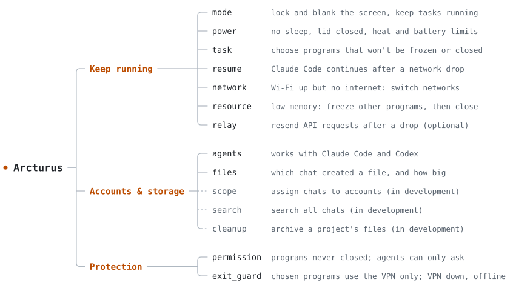

# Arcturus

[](docs/BUILDING.md)
[](docs/BUILDING.md)
[](docs/STATUS.md)
[](LICENSE)

[中文](README.md) · English

Arcturus is a Windows background program for Claude Code and Codex. It does three things:

- **Keep running**: your tasks keep going after you leave the computer.
- **Accounts and storage**: find out which chat created a file; assign chats to different accounts (in development).
- **Protection**: programs that must stay open stay open; when the VPN drops, the programs you chose lose network access.

<picture>
  <source media="(prefers-color-scheme: dark)" srcset="docs/assets/map-en-dark.svg">
  <source media="(prefers-color-scheme: light)" srcset="docs/assets/map-en-light.svg">
  
</picture>

## Keep running

- **Away mode**: Run `away` and the computer locks and turns off the screen while tasks keep running. Run `back` or unlock the computer and every setting it changed goes back. It records each original value first, so it can still restore them after a crash. `back` gives you a report: how long you were gone, how many network drops, which programs were frozen or closed, and the peak temperature.
- **No sleep**: The computer stays awake while a task is protected or away mode is on. On AC power, that includes with the lid closed.
- **Task protection**: Run `protect --pid <id>` to choose a program. It and the programs it starts won't be frozen or closed, and the same goes for the WSL or Docker it uses. Protection ends when the program exits. It also ends after 10 minutes with no activity, but the program is left running.
- **Continue after a network drop**: When Claude Code stops because the network dropped, it continues the same chat once the network is back, with the same permissions and model. If the original window is still open, it continues in a fork and leaves the original chat alone. It tries up to 3 times per drop and waits up to 2 hours. Chats you closed yourself stay closed. Codex only gets a notification for now.
- **Network failover**: When the Wi-Fi is connected but has no internet, Windows doesn't switch by itself. In away mode, Arcturus goes through your other saved networks with phone hotspots last, and switches back when the original returns. Otherwise it only notifies you.
- **Free memory**: In away mode, when available memory falls below 10%, it freezes the programs using the most memory. If that isn't enough after 30 seconds, it closes them. Protected tasks and programs on the list are left alone, and everything is unfrozen when you return.
- **Heat and battery**: When it's too hot or the battery is low, it lowers the CPU frequency first. If it gets worse, it hibernates: with a 60-second countdown when you're there, right away in away mode.
- **API relay**: A small program you start yourself. Point the agent's API address at it and it resends requests after a network drop. Resending costs extra tokens, so it isn't used by default.

## Accounts and storage

- **Find files**: Arcturus reads chat logs and lists which files each chat wrote or downloaded and how much space they take. You can also go the other way: give it a path and find the chat that created it. It can't see downloads whose command doesn't name a path, or files that programs generate on their own unless they land in a folder the chat created.
- **Shared caches**: Hugging Face, pip, conda, npm, Docker and WSL caches are shared, so they're listed separately with the chats that used them, and don't count against any one chat.
- **Supported agents**: Claude Code and Codex. It only reads tested versions, and stops rather than guessing if it can't read the format.

This data stays on your computer. It holds paths, sizes, times and short command summaries, never chat text, and nothing is uploaded.

These are still in development:

- **Assign chats to accounts**: The Claude desktop app keeps its chat list per account, so when you switch accounts you can't see chats from the others. This lets you group chats: some stay on the current account, some go to a few accounts you pick, and some show up on all of them. Chats from one project are grouped by the folders they changed, and you pick by hand when that isn't clear.
- **Search chats**: Search all your Claude Code and Codex chats at once.
- **Cleanup and archive**: When a project ends, list the files that belong only to it, then archive them or move them to a recycle area. You can undo this.

## Protection

- **Programs that can't be closed**: When memory runs out something has to go, so there's a list of programs that are left alone. Windows system programs, security software and Arcturus itself are always on it. Claude, Codex, terminals, VS Code and Office are on it by default. Programs are matched by full path, so the same name in another location doesn't count. Agents can't change the list themselves. They can only ask, and it takes effect when you approve.
- **VPN down, network off**: Some programs you only want going out through a VPN or proxy, but when the VPN drops they usually just use your real connection, and you never find out. Put them on this list and the firewall only lets them use the VPN, so when it drops they're offline. When the network changes, it also checks which country your exit is in. If it can't tell, they're cut off. If the country is wrong, you choose whether they're cut off, frozen or closed. Programs that were cut off come back when the exit is right. It only covers programs on the list, so anything they start has to be added separately. This needs a small Windows service.

The page for editing these two lists is still in development. For now you can view them and submit requests.

## Install

It's early: Windows only, and you build it yourself. Setup notes are in [BUILDING](docs/BUILDING.md).

```powershell
git clone https://github.com/OctopusTide/arcturus
cd arcturus
cargo build --workspace --locked
cd target\debug
```

## Usage

Start the background program and leave this window open:

```powershell
.\away-guard-daemon.exe
```

In another window, also in `target\debug`, connect it to Claude Code. Without `--apply` it only shows what would change:

```powershell
.\away-guard-hook.exe install --agent claude-code --apply
```

Common commands:

```powershell
.\away-guard.exe status                  # battery, temperature, memory, network
.\away-guard.exe protect --pid 12345     # protect a program and what it starts
.\away-guard.exe tasks                   # protected tasks
.\away-guard.exe away                    # enter away mode
.\away-guard.exe back                    # leave away mode
.\away-guard.exe resume show             # chats waiting to continue
.\away-guard.exe network show            # current network
.\away-guard.exe files scan              # count files now
.\away-guard.exe files top               # chats using the most space
.\away-guard.exe files find <path-part>  # which chat created this path
.\away-guard.exe files caches            # shared caches
.\away-guard.exe permission list         # programs that can't be closed
.\away-guard.exe --help                  # all commands
```

## Careful

`away` really acts: it locks the screen, turns off the display, and when memory runs low it freezes or even closes programs that aren't on the list. Save your work first.

Supported versions and known issues are in [Status](docs/STATUS.md).

## Docs

[Architecture](ARCHITECTURE.md) · [Tasks](TASKS.md) · [Interfaces](docs/INTERFACES.md) · [Status](docs/STATUS.md) (in Chinese for now)

## License

[MIT](LICENSE)
