<p align="center">
  <picture>
    <source media="(prefers-color-scheme: dark)" srcset="docs/assets/cover-en-dark.svg">
    <source media="(prefers-color-scheme: light)" srcset="docs/assets/cover-en-light.svg">
    
  </picture>
</p>

<p align="center">
  <a href="README.md">简体中文</a>
</p>

If you run long jobs with Claude Code or Codex, you know the drill.

You walk away, the laptop goes to sleep, and the job dies. Or the Wi-Fi blips, the agent throws an error and stops, and you come back to find it hasn't moved in two hours.

When it does finish, your disk is full of stuff. Two days later you can't remember which chat downloaded what, and you're scared to delete any of it.

And when memory runs out, what gets closed? When your VPN drops, did that program just go out over your real connection?

Arcturus deals with all of that. It runs in the background and keeps an eye on things.

## Keep running

Tell it which task matters and the laptop stays awake, even with the lid shut as long as it's plugged in.

If the network drops, it waits. When the network's back, Claude Code picks up the same conversation. With Codex, it just lets you know.

<p align="center">
  <picture>
    <source media="(prefers-color-scheme: dark)" srcset="docs/assets/story-en-dark.svg">
    <source media="(prefers-color-scheme: light)" srcset="docs/assets/story-en-light.svg">
    
  </picture>
</p>

While you're gone, if the Wi-Fi is connected but dead, it switches to another network you've used. If things get too hot it cools down, and if the battery's nearly out it hibernates.

When you come back, any settings it touched go back to how they were. It won't restart a chat you closed yourself, and a resumed agent never gets more permission than it had.

## Accounts and storage

It reads your chat logs and matches each file to the chat that wrote it. What a chat wrote, what it downloaded, how much space it all takes: you can look it up. Shared stuff like model caches gets its own line, so no single chat gets blamed for it.

<p align="center">
  <picture>
    <source media="(prefers-color-scheme: dark)" srcset="docs/assets/files-en-dark.svg">
    <source media="(prefers-color-scheme: light)" srcset="docs/assets/files-en-light.svg">
    
  </picture>
</p>

All of this stays on your computer. It doesn't keep your chat text, and it doesn't send it anywhere.

## Protection

When memory runs out, something has to go, but some programs can't be closed. So there's a list, and it leaves those alone. An agent can ask to change the list, but you have to say yes.

<p align="center">
  <picture>
    <source media="(prefers-color-scheme: dark)" srcset="docs/assets/guard-list-en-dark.svg">
    <source media="(prefers-color-scheme: light)" srcset="docs/assets/guard-list-en-light.svg">
    
  </picture>
</p>

Some programs you only want going out through a VPN or proxy. But when the VPN drops, they usually just use your real connection, and you never find out.

Add those programs here. If the VPN drops or the exit is in the wrong region, they lose their connection until it's right again. This one needs a very small Windows service installed as well.

<p align="center">
  <picture>
    <source media="(prefers-color-scheme: dark)" srcset="docs/assets/guard-exit-en-dark.svg">
    <source media="(prefers-color-scheme: light)" srcset="docs/assets/guard-exit-en-light.svg">
    
  </picture>
</p>

## Get started

It's early days: Windows only, and you build it yourself. Setup notes are [here](docs/BUILDING.md).

```powershell
git clone https://github.com/OctopusTide/arcturus
cd arcturus
cargo build --workspace --locked
```

Start the background program and leave this window open:

```powershell
.\target\debug\away-guard-daemon.exe
```

In another window, hook it up to Claude Code. Drop `--apply` if you want to see what it would change first:

```powershell
.\target\debug\away-guard-hook.exe install --agent claude-code --apply
```

That's it for network-drop resume. When you're heading out:

```powershell
.\target\debug\away-guard.exe protect --pid 12345   # protect a program, like a training script
.\target\debug\away-guard.exe away                  # I'm leaving
.\target\debug\away-guard.exe back                  # I'm back
```

Careful, `away` really does things: it locks the screen, turns off the display, and if memory runs out it freezes or even closes programs that aren't on the list. Save your work first.

Supported versions and known issues are in [Status](docs/STATUS.md).

---

<p align="center">
  <a href="ARCHITECTURE.md">Architecture</a> · <a href="TASKS.md">Tasks</a> · <a href="docs/INTERFACES.md">Interfaces</a> · <a href="docs/STATUS.md">Status</a> · <a href="LICENSE">MIT</a>
  <br>
  <sub>Those docs are in Chinese for now.</sub>
</p>
