<p align="center">
  <picture>
    <source media="(prefers-color-scheme: dark)" srcset="docs/assets/cover-zh-dark.svg">
    <source media="(prefers-color-scheme: light)" srcset="docs/assets/cover-zh-light.svg">
    
  </picture>
</p>

<p align="center">
  <a href="README.en.md">English</a>
</p>

用 Claude Code、Codex 跑长活，最烦的就这么几件事。

人一走，电脑一睡，活就断了。Wi-Fi 抖一下，它报个错也停了，回来一看，两个小时前就没动过。

跑完硬盘上多出一大堆东西，哪个是哪个对话下的，过两天自己也想不起来，还不敢删。

内存不够了该关谁？VPN 掉了，程序是不是就直接走真实网络连出去了？

Arcturus 就是管这些的。它在后台跑着，替你盯着。

## 使用

告诉它哪个任务要保着，电脑就不会睡，插着电合盖也不睡。

网断了它就等着。网一回来，Claude Code 接着原来的对话干。Codex 的话，它会告诉你一声。

<p align="center">
  <picture>
    <source media="(prefers-color-scheme: dark)" srcset="docs/assets/story-zh-dark.svg">
    <source media="(prefers-color-scheme: light)" srcset="docs/assets/story-zh-light.svg">
    
  </picture>
</p>

人不在的时候，Wi-Fi 连着但上不了网，它会换一个你连过的网。太热了先降温，快没电了就休眠。

等你回来，它动过的设置都会改回去。你自己关掉的对话，它不会去续。续的时候权限也跟原来一样，不会多给。

## 账号和存储

它会去读对话记录，把文件对回当初写它的那个对话。哪个对话写了什么、下了什么、一共多大，一查就有。模型缓存这种大家共用的，单独列一行，不算在谁头上。

<p align="center">
  <picture>
    <source media="(prefers-color-scheme: dark)" srcset="docs/assets/files-zh-dark.svg">
    <source media="(prefers-color-scheme: light)" srcset="docs/assets/files-zh-light.svg">
    
  </picture>
</p>

这些数据都在你自己电脑上，不存聊天内容，也不往外传。

## 保护

内存不够的时候总得关点东西，但有些程序不能关。所以有一份名单，名单上的它不碰。AI 想改这份名单可以，得你点头。

<p align="center">
  <picture>
    <source media="(prefers-color-scheme: dark)" srcset="docs/assets/guard-list-zh-dark.svg">
    <source media="(prefers-color-scheme: light)" srcset="docs/assets/guard-list-zh-light.svg">
    
  </picture>
</p>

有些程序你只想让它走 VPN 或代理。可 VPN 一掉，它们一般就直接走真实网络了，你还不知道。

把这些程序加进来，VPN 掉了或者出口地区不对，它们就直接断网，等出口对了再恢复。这个功能要多装一个很小的 Windows 服务。

<p align="center">
  <picture>
    <source media="(prefers-color-scheme: dark)" srcset="docs/assets/guard-exit-zh-dark.svg">
    <source media="(prefers-color-scheme: light)" srcset="docs/assets/guard-exit-zh-light.svg">
    
  </picture>
</p>

## 开始用

还在早期，只有 Windows 版，得自己编译。环境怎么配看[这里](docs/BUILDING.md)。

```powershell
git clone https://github.com/OctopusTide/arcturus
cd arcturus
cargo build --workspace --locked
```

先把后台跑起来，这个窗口别关：

```powershell
.\target\debug\away-guard-daemon.exe
```

再开一个窗口，把它接到 Claude Code 上。想先看看会改什么，就去掉 `--apply`：

```powershell
.\target\debug\away-guard-hook.exe install --agent claude-code --apply
```

到这一步，断网续跑就能用了。要出门的话：

```powershell
.\target\debug\away-guard.exe protect --pid 12345   # 保护一个程序，比如训练脚本
.\target\debug\away-guard.exe away                  # 我走了
.\target\debug\away-guard.exe back                  # 我回来了
```

注意 `away` 是真的会动手的：锁屏、关屏幕，内存不够还会冻住甚至关掉名单外的程序。用之前把东西存好。

支持哪些版本、有哪些已知问题，看[进度](docs/STATUS.md)。

---

<p align="center">
  <a href="ARCHITECTURE.md">架构</a> · <a href="TASKS.md">任务</a> · <a href="docs/INTERFACES.md">接口</a> · <a href="docs/STATUS.md">进度</a> · <a href="LICENSE">MIT</a>
</p>
