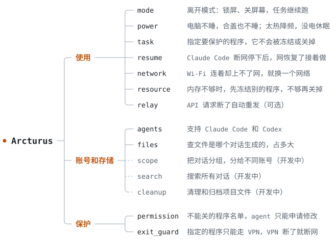

# Arcturus

[](docs/BUILDING.md)
[](docs/BUILDING.md)
[](docs/STATUS.md)
[](LICENSE)

中文 · [English](README.en.md)

Arcturus 是一个 Windows 后台程序，配合 Claude Code 和 Codex 使用。它做三件事：

- **使用**：你离开电脑后，任务继续跑。
- **账号和存储**：查文件是哪个对话生成的；把对话分给不同账号（开发中）。
- **保护**：不能关的程序不会被关；VPN 断了，指定的程序就上不了网。

<picture>
  <source media="(prefers-color-scheme: dark)" srcset="docs/assets/map-zh-dark.svg">
  <source media="(prefers-color-scheme: light)" srcset="docs/assets/map-zh-light.svg">
  
</picture>

## 使用

- **离开模式**：运行 `away`，电脑锁屏、关屏幕，任务继续跑。运行 `back` 或者解锁电脑，就算回来了，改过的设置全部恢复。每改一项都先记下原值，程序崩溃了也能改回去。`back` 会给一份报告：离开了多久、断了几次网、冻结或关掉了哪些程序、最高温度。
- **电脑不睡**：有受保护的任务，或者在离开模式下，电脑都不会睡。插着电的话，合上盖子也不睡。
- **保护任务**：运行 `protect --pid 进程号` 指定一个程序。它和它启动的子程序不会被冻结或关掉，它用到的 WSL、Docker 也一样。程序退出后保护自动取消。连续 10 分钟没有任何动静，也会取消保护，但不会关掉它。
- **断网后接着做**：Claude Code 因为断网停下后，等网恢复了，会自动接着原来的对话做，权限和模型都和原来一样。原来的窗口还开着的话，就另开一个分支接着做，不动原来的对话。同一次断网最多续 3 次，最多等 2 小时。你自己关掉的对话不会续。Codex 现在只发通知。
- **自动换网**：Wi-Fi 连着却上不了网时，Windows 不会自己换。离开模式下，Arcturus 会按顺序连别的已保存网络，手机热点排最后，原来的网恢复了再切回去。平时只通知，不动手。
- **释放内存**：离开模式下，可用内存低于 10% 时，先冻结占内存最多的程序，30 秒后还不够就关掉。受保护的任务和不能关的程序不动。回来时全部解冻。
- **过热和没电**：太热或电量低时，先降低 CPU 频率。再严重就休眠：人在的时候先倒数 60 秒让你存盘，离开模式下直接休眠。
- **API 中转**：一个要自己启动的小程序。把 agent 的 API 地址指向它，断网时它会自动重发请求。重发会多花 token，所以默认不用。

## 账号和存储

- **查文件**：Arcturus 读对话记录，列出每个对话写过和下载过哪些文件、一共占多大。也可以反过来，给一个路径，查它是哪个对话生成的。命令里没写路径的下载查不到；程序运行时自己生成的文件，只有放在对话建的文件夹里才查得到。
- **共用缓存**：Hugging Face、pip、conda、npm、Docker、WSL 这些缓存是共用的，单独列出来，只写哪些对话用过，不算到某个对话头上。
- **支持的 agent**：Claude Code 和 Codex。只读测过的版本，格式认不出就停下，不去猜。

这些数据只存在你的电脑上，只有路径、大小、时间和命令摘要，不存聊天内容，也不上传。

下面几项还在开发：

- **把对话分给不同账号**：Claude 桌面应用的对话列表是按账号分开存的，换一个账号，就看不到别的账号下的对话。这个功能让你给对话分组：有的只留在当前账号，有的分给指定的几个账号，有的所有账号都能看到。同一个项目的对话，按它改过的文件夹自动归到一组，判断不了的手动选。
- **搜索对话**：同时搜 Claude Code 和 Codex 的所有对话。
- **清理和归档**：项目结束时，列出只属于它的文件，可以归档或移到回收区，也可以撤销。

## 保护

- **不能关的程序**：内存不够时总得关点东西，所以有一份名单，名单上的程序不动。Windows 系统程序、安全软件和 Arcturus 自己一直在名单上；Claude、Codex、终端、VS Code、Office 默认也在。程序按完整路径认，同名但位置不同的不算。Agent 不能自己改名单，只能提申请，你批准了才生效。
- **VPN 断了就断网**：有些程序你只想让它走 VPN 或代理，可 VPN 一断，它们一般就直接走真实网络了，你还不知道。把这些程序加进名单，防火墙只放行 VPN，VPN 一断就上不了网。网络有变化时还会查一次出口在哪个国家：查不到就断网，不对可以选断网、冻结或关掉。断网的程序等出口对了自动恢复。只管名单上的程序，它启动的子程序要单独加。这个功能要多装一个小的 Windows 服务。

修改这两份名单的页面还在开发，现在只能查看和提申请。

## 安装

还在早期，目前只有 Windows 版，要自己编译。环境配置见 [BUILDING](docs/BUILDING.md)。

```powershell
git clone https://github.com/OctopusTide/arcturus
cd arcturus
cargo build --workspace --locked
cd target\debug
```

## 用法

启动后台，这个窗口别关：

```powershell
.\away-guard-daemon.exe
```

另开一个窗口，也进到 `target\debug`，接到 Claude Code 上。去掉 `--apply` 只显示会改什么：

```powershell
.\away-guard-hook.exe install --agent claude-code --apply
```

常用命令：

```powershell
.\away-guard.exe status                  # 电量、温度、内存、网络
.\away-guard.exe protect --pid 12345     # 保护一个程序和它的子程序
.\away-guard.exe tasks                   # 受保护的任务
.\away-guard.exe away                    # 进入离开模式
.\away-guard.exe back                    # 退出离开模式
.\away-guard.exe resume show             # 等着续跑的对话
.\away-guard.exe network show            # 当前网络
.\away-guard.exe files scan              # 马上统计一次文件
.\away-guard.exe files top               # 占用最大的对话
.\away-guard.exe files find <路径片段>    # 这个路径是哪个对话生成的
.\away-guard.exe files caches            # 共用缓存
.\away-guard.exe permission list         # 不能关的程序
.\away-guard.exe --help                  # 全部命令
```

## 注意

`away` 会真的动手：锁屏、关屏幕，内存不够时冻结甚至关掉名单外的程序。用之前把东西存好。

支持的版本和已知问题见[进度](docs/STATUS.md)。

## 文档

[架构](ARCHITECTURE.md) · [任务](TASKS.md) · [接口](docs/INTERFACES.md) · [进度](docs/STATUS.md)

## 许可证

[MIT](LICENSE)
